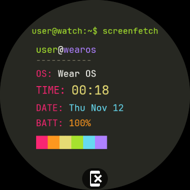

# screenfetch-monokai

A terminal-inspired Wear OS watch face featuring the classic `screenfetch` system info display themed in the Monokai color palette.

Built using the official **Watch Face Format (WFF v1)** for maximum battery efficiency, smoothness, and Wear OS compatibility.

---

## Preview

<p align="center">
  
</p>

---

## Features

- **Monokai Color Palette**: Styled with classic Monokai syntax colors (`#A6E22E` green, `#F92672` pink, `#FD971F` orange, `#E6DB74` yellow, `#66D9EF` cyan, `#AE81FF` purple).
- **Terminal System Info**:
  - `user@wearos` host header with divider.
  - `OS`: Wear OS indicator.
  - `TIME`: 24-hour digital time with leading zeros (`[HOUR_0_23_Z]:[MINUTE_Z]`).
  - `DATE`: Current day of the week, month, and day.
  - `BATT`: Real-time device battery percentage (`[BATTERY_PERCENT]`).
- **Color Swatch Bar**: Monokai terminal color blocks aligned flush with the system info text.
- **Terminal CLI Header**: Top command execution `user@watch:~$ screenfetch`.
- **JetBrains Mono Typography**: Clean monospace font for authentic terminal rendering.
- **Declarative Watch Face Format**: Uses no custom background services or heavy runtimes—battery-friendly and native to Wear OS.

---

## Building

### Requirements
- Android SDK (API level 33+ platform tools and build tools)
- Java 17 or Java 21
- Gradle

### Build Debug APK
```bash
gradle assembleDebug
```
The compiled APK will be generated at:
```text
app/build/outputs/apk/debug/app-debug.apk
```

---

## Installation & Testing

### 1. Install via ADB
Connect your Wear OS watch or start an emulator, then run:
```bash
adb install -r app/build/outputs/apk/debug/app-debug.apk
```

### 2. Set as Active Watch Face (ADB)
To immediately apply the watch face via ADB:
```bash
adb shell am broadcast -a com.google.android.wearable.app.DEBUG_SURFACE --es operation set-watchface --es watchFaceId com.terminal.monokaifetch
adb shell am broadcast -a com.google.android.wearable.app.DEBUG_SYSUI --es operation show-watchface
```

Alternatively, long-press the current watch face on your watch/emulator and select **screenfetch-monokai** from the watch face picker.
